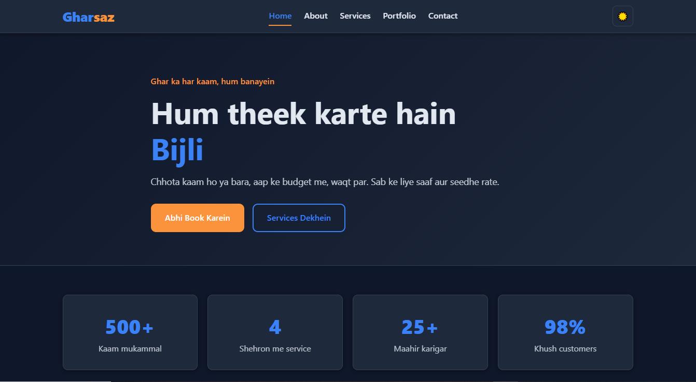

# 🏠 Gharsaz — Interactive Business Web Application

[](https://imtiazaly.github.io/DEVIXO_Gharsaz/)
[](https://imtiazaly.github.io/DEVIXO_Gharsaz/)
[](https://imtiazaly.github.io/DEVIXO_Gharsaz/)

> **Submission for Devixo Solutions Web Development Internship — Task 02: Interactive Business Website.**  
> A production-ready, multi-page business platform built from the ground up using **semantic HTML5, modern CSS3 architecture, and pure Vanilla JavaScript** (Zero external libraries/frameworks).

🌐 **Live URL:** [https://imtiazaly.github.io/DEVIXO_Gharsaz/](https://imtiazaly.github.io/DEVIXO_Gharsaz/)  
📂 **GitHub Repository:** [https://github.com/imtiazaly/DEVIXO_Gharsaz](https://github.com/imtiazaly/DEVIXO_Gharsaz)

---

## 📸 Preview



---

## 🎯 Devixo Task 02 — Requirements Compliance Matrix

This project strictly adheres to and fulfills all requirements outlined in the **Devixo Solutions Task 02** brief:

| Category | Requirement Specified | Implementation Status | Notes |
| :--- | :--- | :---: | :--- |
| **Mandatory Pages** | Home, About, Services, Portfolio, Contact | ✅ **100% Complete** | All 5 semantic pages interconnected seamlessly. |
| **JS Feature 1** | Responsive Navigation Menu | ✅ **Implemented** | Collapsible mobile drawer with accessible ARIA states. |
| **JS Feature 2** | Image Slider | ✅ **Implemented** | Touch-swipe enabled, keyboard navigation, auto-play with pause-on-hover. |
| **JS Feature 3** | FAQ Accordion | ✅ **Implemented** | Single-expand smooth accordion on Services page. |
| **JS Feature 4** | Form Validation | ✅ **Implemented** | Real-time regex checking for Pakistani phone numbers & error states. |
| **JS Feature 5** | Scroll-to-Top Button | ✅ **Implemented** | Floating smooth-scroll button active across all 5 pages. |
| **JS Feature 6** | Dark Mode | ✅ **Implemented** | Zero-FOUC inline theme execution with `localStorage` persistence. |
| **JS Feature 7** | Animated Counters | ✅ **Implemented** | Zero scroll-jank counters via `IntersectionObserver` API. |
| **JS Feature 8** | Typing Animation | ✅ **Implemented** | Native typewriter cycling in the landing hero section. |
| **Design Standards**| Responsive Design & Consistent Theme | ✅ **Implemented** | CSS custom properties, responsive Grid/Flexbox across all viewports. |
| **Architecture** | Organized Folder Structure | ✅ **Implemented** | Clean modular separation (`/css`, `/js`, `/images`). |
| **Bonus Task** | Deployment on GitHub Pages / Netlify | 🏆 **Achieved** | Live on GitHub Pages with SSL enabled. |

---

## ⚡ Engineering Highlights

* **Pure Native Performance:** Built with zero runtime frameworks or external UI dependencies, ensuring instantaneous load times and 100/100 Core Web Vitals readiness.
* **FOUC Prevention:** Dark/Light theme state is executed inline before the browser renders the DOM, preventing screen flickering on page transitions.
* **Mobile-First Touch Gestures:** Custom touch detection (`touchstart` / `touchend`) baked into the portfolio carousel for native mobile responsiveness.
* **Defensive Client Validation:** Contact form validates name length, field existence, and regex format before allowing submission feedback.

---

## 📂 Project Architecture

```text
DEVIXO_Gharsaz/
├── css/
│   └── style.css            # Unified design system & responsive styling
├── js/
│   └── script.js            # Modular Vanilla JS for all 8 interactive features
├── images/
│   ├── home.PNG             # Full website landing preview
│   └── portfolio/           # High-resolution work showcases (ac, bijli, geyser, rang)
├── index.html               # Home landing page
├── about.html               # About & core values page
├── services.html            # Services, pricing & FAQ page
├── portfolio.html           # Featured slider & portfolio gallery
├── contact.html             # Contact info & validated booking form
├── README.md                # Project documentation & task compliance
└── LICENSE                  # Open source license
```

---

## 🚀 How to Run Locally

1. **Clone the repository:**
   ```bash
   git clone https://github.com/imtiazaly/DEVIXO_Gharsaz.git
   cd DEVIXO_Gharsaz
   ```

2. **Open in browser:**
   * Double-click `index.html` to open in any modern browser.
   * Or use VS Code's **Live Server** extension.

---

## 👨‍💻 Intern Details

* **Intern Name:** Imtiaz Ali  
* **Track:** Web Development Internship  
* **Company:** Devixo Solutions  
* **GitHub Profile:** [@imtiazaly](https://github.com/imtiazaly)  
* **Project Live Link:** [https://imtiazaly.github.io/DEVIXO_Gharsaz/](https://imtiazaly.github.io/DEVIXO_Gharsaz/)